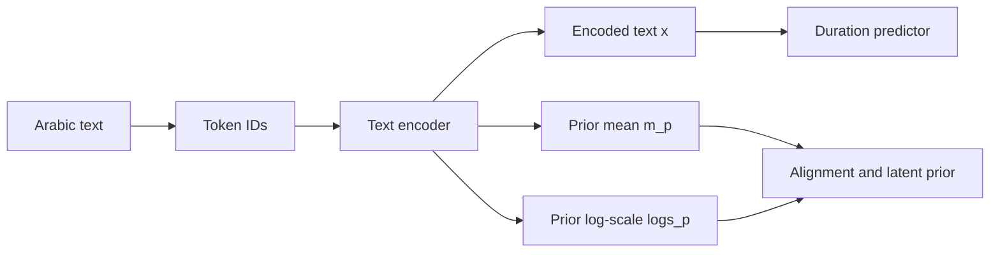

# Text Encoder and Prior Distribution for VITS2

This chapter begins with the padded token IDs, lengths, and masks produced in Chapter 04. It builds the Transformer-based text encoder and ends with the parameters of VITS2's text-conditioned prior distribution.

The complete contract is:

```text
token IDs [B, T_text] + lengths [B]
    -> embeddings [B, T_text, C_hidden]
    -> optional speaker conditioning
    -> transpose [B, C_hidden, T_text]
    -> masked Transformer encoder
encoded text [B, C_hidden, T_text]
    -> 1x1 projection to 2 * C_latent channels
prior mean m_p      [B, C_latent, T_text]
prior log-scale     [B, C_latent, T_text]
```

This chapter does **not** align text tokens to acoustic frames. Its outputs still have one time position per text token. Monotonic Alignment Search later connects these text positions to mel-frame positions.

## Learning objectives

By the end of this chapter, you should be able to explain and verify:

- Why token IDs become learned vectors through an embedding table.
- Why the reference initializes embeddings with standard deviation `C_hidden**-0.5` and then multiplies them by `sqrt(C_hidden)`.
- How speaker conditioning broadcasts one speaker vector over all text positions.
- Why VITS2 repeatedly moves between `[B, T, C]` and `[B, C, T]`.
- Which dimension `LayerNorm` normalizes.
- How `1x1` convolutions produce queries, keys, and values without changing time length.
- How channels split into multiple attention heads.
- Why attention logits are divided by `sqrt(head_dim)`.
- Why the attention mask is broadcast to `[B, 1, 1, T_key]`.
- Why key masking and final query-position masking are separate responsibilities.
- How attention heads are merged back into `[B, C, T]`.
- How the convolutional feed-forward network preserves time length.
- Why residual additions require matching shapes.
- How pre-normalization, residual connections, dropout, and masking form one encoder layer.
- How several layers are stacked without changing the external shape.
- Why the final projection has `2 * C_latent` output channels.
- Why `logs_p` is a log standard deviation, not a log-variance.
- How `m_p` and `logs_p` define a diagonal Gaussian prior per text position.
- How to prove padded token values cannot affect valid outputs.

## Prerequisite

Complete [Chapter 04](../04-text-processing-and-batching/README.md) first. This chapter assumes:

```text
text IDs:      [B, T_text], torch.long
text lengths:  [B], torch.long
text mask:     [B, 1, T_text]
```

You should already understand broadcasting, padding, original lengths, and the difference between token IDs and embeddings.

## 1. Where the text encoder sits in VITS2



The text encoder has two related jobs:

1. Produce contextual text features `x` for modules such as the duration predictor.
2. Predict a Gaussian prior distribution over latent acoustic features using `m_p` and `logs_p`.

The encoder does not directly create audio and does not yet know how many acoustic frames each token occupies.

## 2. Production configuration versus learning configuration

The project's base configuration uses:

```text
C_hidden       = 192
C_filter       = 768
n_heads        = 2
head_dim       = 192 / 2 = 96
n_layers       = 6
kernel_size    = 3
dropout        = 0.1
C_latent       = 192
speaker_dim    = 256
```

The notebook uses smaller values such as:

```text
C_hidden       = 8
C_filter       = 16
n_heads        = 2
head_dim       = 4
n_layers       = 2
C_latent       = 6
speaker_dim    = 5
```

The operations and shape rules are identical. Small dimensions make every intermediate tensor inspectable and keep the attention matrix easy to reason about.

## 3. Embedding lookup and scaling

An embedding table has shape:

```text
[n_vocab, C_hidden]
```

Each token ID selects one row:

```text
token IDs  [B, T_text]
embedding  [B, T_text, C_hidden]
```

The reference initializes the table using approximately:

```text
embedding weight standard deviation = C_hidden ** -0.5
```

and scales looked-up vectors by:

```text
sqrt(C_hidden)
```

The two factors approximately cancel at initialization:

```text
C_hidden**-0.5 * C_hidden**0.5 = 1
```

The purpose is scale control. The embedding table uses a dimension-aware initialization while the vectors entering the encoder begin with an order-one standard deviation rather than shrinking as hidden size grows.

This is an approximate statistical statement. A small finite tensor will not have an observed standard deviation exactly equal to the requested value.

## 4. Optional speaker conditioning

For multi-speaker synthesis, the reference receives one speaker embedding per sample:

```text
speaker embedding [B, C_speaker]
```

A linear layer projects it into the text hidden space:

```text
[B, C_speaker] -> [B, C_hidden]
```

Then a singleton time dimension is inserted:

```text
[B, C_hidden] -> [B, 1, C_hidden]
```

This broadcasts over the text embeddings:

```text
text features       [B, T_text, C_hidden]
speaker condition   [B, 1,      C_hidden]
sum                 [B, T_text, C_hidden]
```

The same speaker vector is added at every token position, but each sample receives its own vector.

If `speaker_cond_dim == 0` or no speaker embedding is passed, this addition is skipped.

## 5. Two layout conventions

Different operations prefer different layouts:

```text
LayerNorm and readable token rows: [B, T, C]
Conv1d:                            [B, C, T]
```

The embedding output begins as `[B, T, C]`, then the text encoder transposes it to `[B, C, T]`.

Inside each encoder layer, the reference temporarily transposes back to `[B, T, C]` before `LayerNorm(C)`, because PyTorch `LayerNorm(C)` normalizes the final dimension. It then transposes to `[B, C, T]` for attention projections and convolutions.

The transpose changes layout, not meaning. No data is discarded.

## 6. Sequence masks inside the encoder

Lengths create a Boolean mask:

```text
lengths [B]
    -> mask [B, T]
    -> unsqueeze
x_mask [B, 1, T]
```

The reference converts the mask to the same floating dtype as the features. It then uses the mask at several boundaries:

- before entering the Transformer stack;
- inside the feed-forward network;
- after each complete encoder layer;
- after the prior projection.

Repeated masking is intentional. Bias terms, convolutions, attention outputs, and residual paths can make padded positions nonzero again after an earlier mask.

## 7. Queries, keys, and values

Self-attention derives three representations from the same input:

```text
input x [B, C, T]
    -> query projection Q [B, C, T]
    -> key projection   K [B, C, T]
    -> value projection V [B, C, T]
```

Each projection is a `Conv1d(C, C, kernel_size=1)`. A `1x1` convolution mixes channels independently at each time position. It does not look at neighboring tokens and does not change `T`.

Conceptually:

- Query: what information is this position requesting?
- Key: what information does this position advertise?
- Value: what content should be collected if this position is attended to?

These meanings are learned, not manually assigned.

## 8. Splitting channels into heads

The hidden-channel count must be divisible by the number of heads:

```text
head_dim = C_hidden // n_heads
C_hidden % n_heads == 0
```

The reference reshapes:

```text
[B, C_hidden, T]
    -> [B, n_heads, head_dim, T]
```

No new values are created. The channel dimension is reorganized into `n_heads * head_dim`.

Each head can learn a different relationship between tokens. Heads operate in parallel and are concatenated afterward.

## 9. Scaled dot-product attention

After transposing query time and head dimensions:

```text
Q: [B, H, T_query, D]
K: [B, H, D, T_key]
```

matrix multiplication produces:

```text
scores = Q @ K
scores.shape == [B, H, T_query, T_key]
```

Every score compares one query position with one key position for one head.

The scores are scaled:

```text
scaled_scores = scores / sqrt(head_dim)
```

Without scaling, dot-product magnitude tends to grow with `head_dim`. Large logits can make softmax extremely sharp and its gradients poorly behaved. Dividing by `sqrt(head_dim)` keeps the logit scale more stable.

## 10. Attention masking

The text mask begins as:

```text
[B, 1, T_key]
```

The reference inserts another dimension:

```text
[B, 1, 1, T_key]
```

This broadcasts across:

- all heads;
- all query positions;
- the key-position dimension remains explicit.

Invalid key logits are replaced by a very negative value before softmax:

```text
scores.masked_fill(key_is_padding, -1e4)
```

Their probabilities therefore become approximately zero.

### Key masking is not query masking

The attention mask prevents valid queries from reading padded **keys**. It does not itself guarantee that padded **query rows** are zero. The output projection also has a bias, so padded time positions can become nonzero.

The encoder layer solves this second problem by multiplying the completed layer output by `[B, 1, T]`. Thus:

```text
attention mask -> padded keys cannot contribute
layer output mask -> padded query positions become zero
```

These are distinct responsibilities.

## 11. Softmax and weighted values

Softmax is applied over the final dimension—the key positions:

```text
attention = softmax(scores, dim=-1)
```

For every batch item, head, and query position:

```text
sum over valid key probabilities ≈ 1
```

The attention probabilities weight the values:

```text
attention [B, H, T_query, T_key]
V         [B, H, T_key, D]
output    [B, H, T_query, D]
```

The reference then rearranges and merges heads:

```text
[B, H, T, D]
    -> [B, H, D, T]
    -> [B, C_hidden, T]
```

A final `1x1` output projection mixes information across heads.

## 12. Convolutional feed-forward network

The feed-forward network uses:

```text
[B, C_hidden, T]
    -> Conv1d(C_hidden, C_filter, kernel_size)
    -> GELU
    -> Dropout
    -> Conv1d(C_filter, C_hidden, kernel_size)
    -> [B, C_hidden, T]
```

With odd kernel size `k`, padding:

```text
(k - 1) // 2
```

preserves time length when stride and dilation are `1`.

Unlike the `1x1` attention projections, a kernel such as `3` mixes neighboring token positions. This provides local order-sensitive processing.

The reference does not add an explicit absolute or relative positional embedding. Self-attention alone is permutation-equivariant; the convolutional FFN introduces local sequential structure, including boundary effects. This is a property of this specific simplified reference design and should be recognized rather than silently assumed to be a standard Transformer detail.

## 13. One pre-normalized encoder layer

One layer performs:

```text
residual = x
x = LayerNorm(x)
x = self_attention(x)
x = residual + Dropout(x)

residual = x
x = LayerNorm(x)
x = feed_forward(x)
x = residual + Dropout(x)
x = x * mask
```

Normalization happens before each sublayer, so this is a **pre-norm** design.

Residual addition requires identical shapes. Both attention and the FFN return `[B, C_hidden, T]`, preserving the input shape.

Residual paths help information and gradients move through deep stacks. Dropout regularizes the learned residual update during training. In evaluation mode, dropout is disabled.

## 14. Stacking layers

The Transformer encoder stores `n_layers` copies in a module list and applies them sequentially:

```text
x_0 -> layer 1 -> x_1 -> layer 2 -> ... -> x_n
```

Every layer preserves:

```text
[B, C_hidden, T_text]
```

The values become increasingly contextual, but the external shape remains stable.

Attention memory and compute grow approximately with `T_text²` because every query is compared with every key. Text sequences are usually much shorter than waveform or mel sequences, which makes global text attention practical.

## 15. Projection to the prior parameters

The final text features are projected with:

```text
Conv1d(C_hidden, 2 * C_latent, kernel_size=1)
```

The result is split equally along the channel dimension:

```text
stats  [B, 2 * C_latent, T_text]
m_p    [B, C_latent, T_text]
logs_p [B, C_latent, T_text]
```

The mask is applied after projection so padded positions in both outputs are zero.

### `logs_p` means log standard deviation

The reference class docstring says “log-variance,” but the actual equations use `logs_p` as a log standard deviation (log-scale):

```text
standard deviation = exp(logs_p)
variance           = exp(2 * logs_p)
```

This is confirmed by inference sampling:

```text
z_p = m_p + epsilon * exp(logs_p) * noise_scale
epsilon ~ Normal(0, 1)
```

and by likelihood/KL expressions containing `exp(-2 * logs_p)`.

Calling it log-variance would introduce a factor-of-two error.

## 16. What the prior represents

For each valid text position and each latent channel, the encoder predicts a diagonal Gaussian:

```text
p(z | text) = Normal(m_p, exp(logs_p)^2)
```

“Diagonal” means the distribution predicts one scale per latent element and does not explicitly model a full covariance matrix between channels.

During training, acoustic information passes through the posterior encoder and flow. Monotonic alignment connects acoustic latent frames with these text-token prior parameters. During inference, predicted durations expand token-level `m_p` and `logs_p` over acoustic time before sampling.

The prior output at this chapter remains token-length:

```text
T_prior == T_text
```

## 17. Proving padding invariance

A strong mask test is not merely checking that padded outputs equal zero.

Construct two input batches that have:

- identical valid token prefixes;
- identical lengths;
- different token IDs only in padded positions.

Run the encoder in evaluation mode and compare valid outputs:

```text
x_valid, m_p_valid, logs_p_valid
```

They should be equal within floating-point tolerance. This proves padded token identities cannot influence valid positions through embeddings, attention keys, convolutions, or residual paths.

Also verify every padded position is exactly zero after masking.

## 18. Reference implementation observations

The local reference has these relevant choices:

- embedding weights initialized with `hidden_channels**-0.5`;
- embedding outputs multiplied by `sqrt(hidden_channels)`;
- optional speaker projection added before transpose;
- `Conv1d` for query, key, value, attention output, FFN, and prior projection;
- key masking inside attention;
- final time masking after each encoder layer;
- no explicit positional embedding;
- `logs_p` used as log standard deviation despite a misleading docstring phrase.

The notebook independently implements this behavior, then loads the same weights into the reference class and compares all four outputs.

# Experiment roadmap

The canonical notebook is `experiment.ipynb`. Each task contains executable assertions and shape prints.

## Task 1: Recreate the input contract

Create a small padded token batch and lengths. Build `[B, 1, T]` and verify:

```text
mask.sum per row == lengths
```

## Task 2: Embedding initialization and scaling

Build the embedding table, initialize it with `C_hidden**-0.5`, look up the tokens, and multiply by `sqrt(C_hidden)`. Compare empirical standard deviations before and after scaling.

## Task 3: Speaker conditioning

Project `[B, C_speaker]` to `[B, C_hidden]`, unsqueeze time, add it to every token, and prove the added vector is constant across time for each sample.

## Task 4: Layouts and LayerNorm

Move from `[B, T, C]` to `[B, C, T]` and back. Apply `LayerNorm(C)` only when channels are last. Verify shape preservation and inspect per-token means.

## Task 5: Q/K/V projections and head splitting

Use `1x1` convolutions and reshape each projection into `[B, H, D, T]`. Assert `C == H * D` and show that time length is unchanged.

## Task 6: Scaled scores and key masking

Compute `[B, H, T, T]`, compare scaled and unscaled logit magnitudes, broadcast the key mask to `[B, 1, 1, T]`, apply softmax, and verify masked key probabilities are approximately zero.

## Task 7: Weighted values and head merging

Multiply attention probabilities by values, merge the heads, apply the output projection, and recover `[B, C, T]`.

## Task 8: Convolutional FFN

Implement the masked two-convolution FFN. Verify expansion to `C_filter`, contraction to `C_hidden`, time preservation, and zero padded outputs.

## Task 9: One encoder layer

Combine pre-norm attention, pre-norm FFN, residual connections, dropout, and final masking. Verify shape preservation and zero padded positions.

## Task 10: Stack encoder layers

Apply multiple independent layers in order. Verify that layer count changes model depth, not the external tensor shape.

## Task 11: Prior projection and split

Project to `2 * C_latent`, mask, split into `m_p` and `logs_p`, and verify both shapes.

## Task 12: Interpret and sample the Gaussian

Calculate:

```text
std = exp(logs_p)
variance = exp(2 * logs_p)
sample = m_p + epsilon * std
```

Verify scales are positive and padded samples remain zero after applying the mask.

## Task 13: Assemble the full text encoder

Combine all components into one module with the same external contract as the reference:

```text
x, m_p, logs_p, x_mask = encoder(text, lengths, speaker_embedding)
```

## Task 14: Prove padding invariance

Change only padded token IDs. In evaluation mode, prove valid outputs remain equal and padded outputs remain zero.

## Task 15: Compare with the reference

Load the local reference encoder without importing unrelated audio dependencies. Copy the independent model's state dictionary into it and verify all four outputs match numerically.

## Task 16: Final chapter assertions

Collect the structural and semantic invariants in one readable checkpoint.

# Debugging strategy

When a test fails, inspect in this order:

1. Print token shape, dtype, lengths, and maximum token ID.
2. Confirm every token ID is smaller than `n_vocab`.
3. Confirm embedding output is `[B, T, C]`.
4. Confirm speaker projection is `[B, C]` before unsqueezing.
5. Confirm the mask is `[B, 1, T]` and uses the feature device.
6. Label the current layout before every transpose.
7. Confirm `C_hidden % n_heads == 0`.
8. Print Q, K, V shapes before matrix multiplication.
9. Confirm score shape is `[B, H, T_query, T_key]`.
10. Confirm softmax operates over key positions (`dim=-1`).
11. Inspect attention mass assigned to padded keys.
12. Confirm merged heads are contiguous before `view`.
13. Confirm FFN padding preserves time length.
14. Confirm residual operands have identical shapes.
15. Reapply the time mask after operations with bias.
16. Confirm the prior projection has exactly `2 * C_latent` channels.
17. Split along channels, not time.
18. Compare valid and padded positions separately.
19. Disable dropout with `eval()` for deterministic equivalence tests.
20. Locate the first intermediate tensor that differs from the reference.

## Common reasoning mistakes

### “Attention creates a new time length”

Self-attention produces one output for each query position. Here query and key sequences are the same text sequence, so output time remains `T_text`.

### “The attention mask zeros padded queries”

The reference attention mask targets key columns. The encoder layer's final `[B, 1, T]` multiplication zeros padded query positions.

### “LayerNorm(C) works directly on `[B, C, T]`”

PyTorch `LayerNorm(C)` expects the final dimension to have size `C`. The reference transposes to `[B, T, C]` first.

### “Head splitting duplicates the tensor”

It reorganizes `C` into `H * D`. The number of elements does not change.

### “`logs_p` is log-variance because the docstring says so”

The equations determine semantics. `exp(logs_p)` is used as standard deviation, so `logs_p` is log-scale.

### “Masking once is enough”

Biases and neighboring operations can recreate nonzero padded values. Mask at the boundaries where the model contract requires zeros.

### “A zero padded output proves padding cannot affect valid tokens”

Not necessarily. Use the stronger perturbation test: alter padded input IDs and verify valid outputs remain unchanged.

### “Dropout mismatch means two implementations are different”

Training-mode dropout is random. Use evaluation mode or identical controlled randomness for deterministic comparison.

# Questions you must be able to answer

1. Why are embedding rows initialized with a hidden-size-dependent standard deviation?
2. Why are embeddings multiplied by `sqrt(C_hidden)`?
3. How does speaker conditioning broadcast over time?
4. Why does the encoder alternate between `[B, T, C]` and `[B, C, T]`?
5. Why must `C_hidden` be divisible by `n_heads`?
6. What does one element of `[B, H, T, T]` represent?
7. Why divide attention scores by `sqrt(head_dim)`?
8. Why is the attention mask `[B, 1, 1, T_key]`?
9. Which axis receives softmax, and why?
10. Why are key masking and query-output masking different?
11. Why does the FFN use an odd kernel with symmetric padding?
12. What information do residual connections preserve?
13. What makes the layer pre-norm?
14. Why does the prior projection output twice the latent-channel count?
15. How do `logs_p`, standard deviation, and variance relate?
16. Why do prior outputs still use text time rather than mel time?
17. What does the padded-input perturbation test prove?
18. What sequential information is supplied by the convolutional FFN in this reference?

# Chapter completion criteria

Chapter 05 is complete when you can explain every transition in:

```text
[B, T]
 -> [B, T, C_hidden]
 -> [B, C_hidden, T]
 -> Q/K/V [B, H, D, T]
 -> scores [B, H, T, T]
 -> encoded x [B, C_hidden, T]
 -> stats [B, 2*C_latent, T]
 -> m_p and logs_p [B, C_latent, T]
```

and the notebook proves:

1. Every component preserves the documented shape contract.
2. Masked attention assigns negligible probability to padded keys.
3. Encoder and prior outputs are zero at padded time positions.
4. Changing padded token IDs does not change valid outputs.
5. `exp(logs_p)` is positive and acts as standard deviation.
6. The independent encoder matches the local reference under identical weights.
7. The production configuration can be derived from the same small-dimension equations.

The next chapter builds the **posterior encoder**, which converts observed mel features into acoustic latent samples and predicts its own mean and log-scale.
